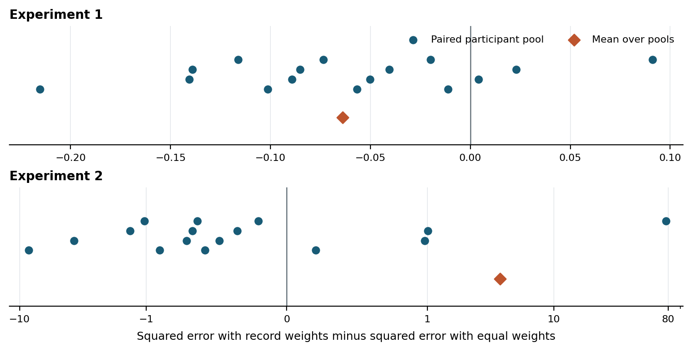

# Using accuracy records and lottery seats in advisory panels

This repository accompanies *Accuracy and influence in councils selected by track record and lottery* by Aruma Harada. The November 2026 revision combines a reproducible simulation with a held-out analysis of human judgments on political facts.

**Read the November preprint** · [PDF](paper/PKD_preprint_november.pdf) · [Word](paper/PKD_preprint_november.docx) · [Markdown](paper/PKD_preprint_november.md)

## What changes when a seat is reserved for the lottery?

In the ten-seat simulation, five lottery members carry 13.3% of the input weight. The fixed-membership comparison shows what weighting contributes over and above who gets in. In the two human experiments, the five lottery seats carry 30.6% and 9.1% of the weight. Record weighting lowered average error in the first experiment. In the second, a large miss in one participant pool changed the sign of the mean comparison. Each experiment has four held-out questions and 16 participant pools. The original study and its replication data are available from [Becker, Porter & Centola (2019)](https://doi.org/10.1073/pnas.1817195116) and [Harvard Dataverse](https://doi.org/10.7910/DVN/OE6UMR).



A separate experiment lets five agents choose between their own estimates and the council’s last public estimate. Each institution has its own score and output history. A permanent commitment to copying causes substantial loss in the mixed council. Learners who start without a preference copy much less. An initial preference for copying raises full-run error and fades later. An audit on synthetic party labels also distinguishes coverage of the lottery’s target strata from representation on a separate attribute.

## Run the November studies

Use Python 3.12 and install the repository dependencies with `python -m pip install -r requirements-lock.txt`. From the repository root:

```bash
python -m pytest -q
python verify_november.py
python citizen_variance.py --workers 4 --output rerun/citizen_noise_runs.csv
python adaptive_panels.py --workers 4 --output rerun/adaptive_runs.csv
python empirical_panels.py --output rerun/empirical_folds.csv
python verify_november.py --directory rerun --write
```

The human-data command downloads and verifies the public author-supplied CSV. Pass `--input PATH` to use a local copy. Only aggregate fold summaries are distributed here. The audit recomputes 702 summaries and checks 360 baseline run-by-rule errors against the earlier archive. [Run-level data and estimates](results/november_2026) · [Experimental design and provenance](REPRODUCIBILITY.md)

## September and October studies

[October preprint](paper/PKD_preprint_v2.pdf) · [September archive](results/preprint_2026) · [October observer study](results/review_2026) · [Japanese guide to the October version](paper/EXPLANATION_JA.md)

The September study varies panel selection, voting information, scoring feedback and fixed reporting strategies. The October follow-up separates membership, aggregate weights and confidence-based updating on matched draws. Their model and archived outputs are retained for byte-level verification.

```bash
python verify_preprint.py
python verify_review.py
python reproduce_preprint.py --workers 4 --output results/rerun
python analyze_preprint.py --input results/rerun
python review_archived.py --input results/rerun --output results/review-rerun/archived_analysis
python review_followup.py --workers 4 --output results/review-rerun/followup
```

The manuscript is a preprint. Software is distributed under the [MIT license](LICENSE). The original researchers retain the terms of their empirical dataset. The manuscript’s AI-assisted drafting and analysis are disclosed in its declarations. [Citation metadata](CITATION.cff) · [Change history](CHANGELOG.md)

