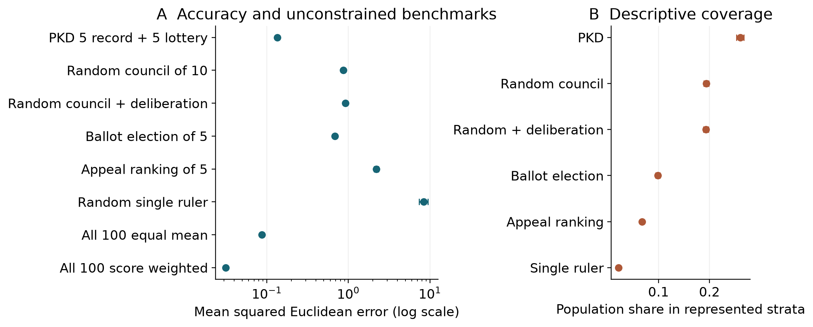
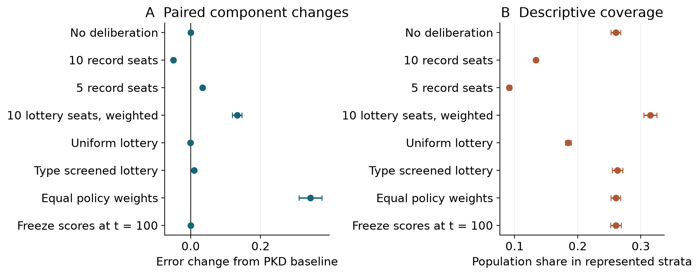
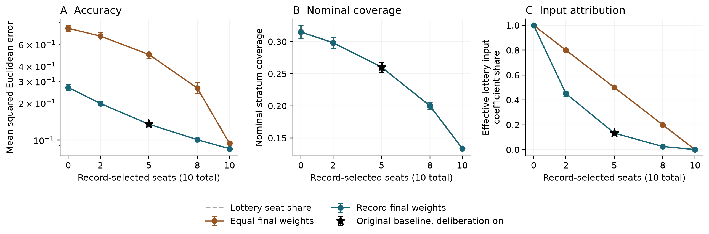
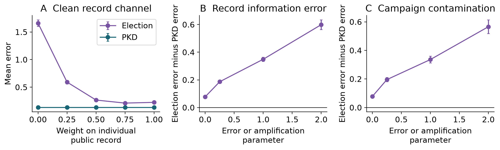
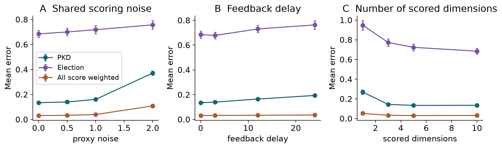
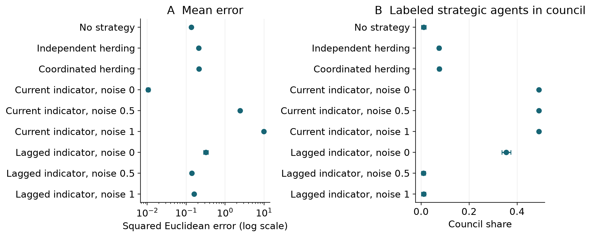
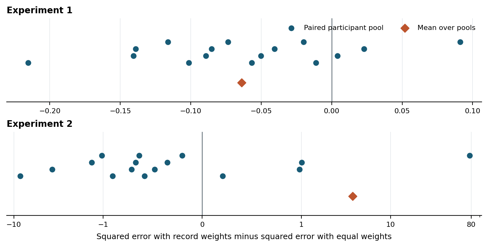
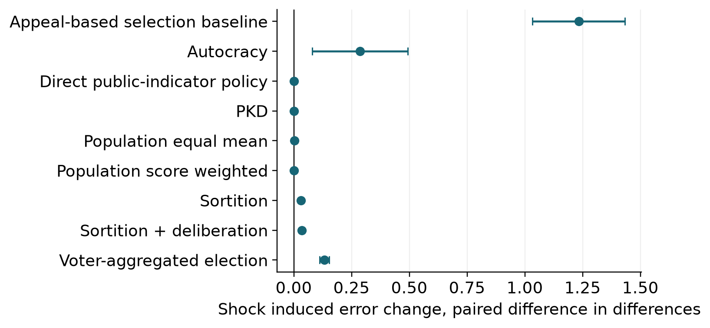
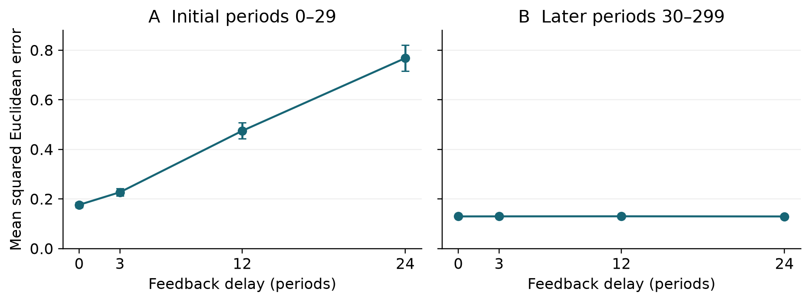

# Accuracy and influence in councils selected by track record and lottery

Aruma Harada

Independent Researcher

ORCID 0009-0005-6674-5165

November 2026 revision | 22 November 2026 | Preprint

## Abstract

A lottery can change who sits on an advisory panel while leaving much of the final estimate in the hands of its highest-scoring members. I separate these effects in ten-seat councils that allocate five places by past accuracy and five by stratified lottery. In a common-state simulation, the lottery broadens coverage of declared strata. Its members occupy half the seats but receive 13.3% of the aggregate weight. Equal weighting of identical councils increases estimation error. I then reconstruct panels from first-round answers in two published experiments on quantitative political knowledge, scoring participants on three questions and holding out a fourth. The lottery receives 30.6% and 9.1% of the weight in the two experiments. Record weighting reduces mean squared error in the first. In the second, a single participant pool reverses the direction of the mean comparison. A separate simulation lets agents learn whether to report a private estimate or copy the last panel output. An initial preference for copying increases early uptake and full-run loss. Across these comparisons, reserving seats and allocating input weight have distinct, measurable consequences. The accuracy gained from weighting depends on how well an individual’s record transfers to the next task and on the cost of occasional large errors.

Keywords: agent-based simulation; collective estimation; prediction aggregation; sortition; bounded confidence; model verification

## 1 Introduction

An advisory panel can recruit people from more backgrounds and still base most of its estimate on a few members. To see how this happens, consider two decisions an organizer makes: who receives a seat, and how the panel combines the estimates of those seated. I study a rule originally called Philosopher-King Democracy (PKD). It reserves seats for a stratified lottery, selects the remaining members by past accuracy, and weights their estimates by those same records.

These decisions call for different comparisons. Holding panel size and weighting fixed reveals what a lottery seat adds to coverage and costs in estimation error. Holding the actual members fixed reveals what weighting does to their influence. If every candidate already supplies a scored estimate, the pool of all submissions provides a third benchmark: the accuracy available before imposing a seat limit.

The experiment gives each agent a noisy observation of the same current state. Every estimate can therefore be scored against a common outcome. This makes it possible to trace a difference in collective error to the selection rule, the information it uses or the way it combines members’ inputs.

I estimate each member’s coefficient in the panel output and compare councils with the same members, information and number of seats. A synthetic experiment identifies the consequences of each rule under known observation errors. A secondary analysis of public human responses asks which of those patterns transfer across factual questions. Finally, a simulation with institution-specific public histories tests whether feedback sustains copying. The common outcomes are collective error, descriptive composition and the weight attached to each route of entry.

## 2 Relation to prior work

In prediction with expert advice, an aggregator can assign weights using a forecaster’s past losses (Cesa-Bianchi and Lugosi, 2006). PKD uses a discounted history of squared errors twice, first for admission to part of the council and again to combine the members’ submissions. Comparing this arrangement with population-wide weighting measures the cost of restricting participation in the aggregate.

DeGroot (1974) models consensus through opinion averaging. Hegselmann and Krause (2002) restrict interaction to sufficiently close estimates, and Lorenz (2010) allows that threshold to vary by agent. Golub and Jackson (2010) examine when social learning aggregates dispersed information. Here members take one synchronous averaging step on fresh inputs. The resulting aggregate can be expressed in terms of the original estimates, so the weight each member ultimately receives can be measured directly.

For deliberative assemblies, Landemore (2013) links random selection to the inclusion of diverse problem-solving perspectives. Flanigan et al. (2021) study how assembly selection rules affect individuals’ chances of inclusion. PKD addresses a subsequent design choice: once a member is seated, how much of their estimate enters the panel output? I report the population share covered by occupied strata alongside the coefficients on those members’ estimates.

Hong and Page (2004) study solvers who use different perspectives and heuristics to search for solutions. In PKD, agents observe the same quantity with different precision and some have systematic bias. A seat can thus broaden coverage of declared strata and at the same time introduce a less precise estimate. The fixed-membership comparison tests how pooling handles that combination.

Mellers et al. (2014) use resolved geopolitical forecasts to study tracking, training and teaming. Becker, Porter and Centola (2019) elicit repeated estimates of political facts in two experiments. I use the latter study’s first-round submissions to evaluate panel formation and weighting on held-out questions. Its original experiment concerned social learning. Here the estimand is the error of a reconstructed panel from submitted estimates, before any within-question revision.

Brennan (2016) frames the political question of competence and authority. Here the estimand is the accuracy of an advisory output. Following Edmonds et al. (2019), I use simulation to isolate mechanisms. Appendix A documents the model using the ODD protocol (Grimm et al., 2020).

## 3 Model and analytical expectations

### 3.1 State and registered estimates

The baseline population comprises 80 citizens in four groups, 15 agents with low observation noise, and five agents with high appeal, systematic bias and a narrow confidence radius. I call this last group the high-appeal biased group. Its confidence radius limits which neighbors it listens to. Every group uses the same revision rate once neighbors qualify. All agents may earn record seats, and all remaining agents are eligible for the baseline lottery.

The state θ(t) has ten dimensions at baseline. It begins as a centered Gaussian vector with per-coordinate standard deviation 0.5. Before each decision, it is redrawn from N(0,I) with probability 0.03; otherwise independent Gaussian drift of standard deviation 0.02 is added. Each agent registers a vector x<sub>i</sub>(t) with fixed bias b<sub>i</sub> and independent coordinate errors. One or two randomly assigned specialty coordinates have 0.3 times the agent's usual observation-noise standard deviation.

$$
x_i(t)=\theta(t)+b_i+\varepsilon_i(t),\qquad L_s(t)=\|p_s(t)-\theta(t)\|^2\tag{1}
$$

Table A1 gives the observation standard deviations and population shares. Only the high-appeal biased group receives a systematic error. Its initial bias has norm 1.5 and an independently sampled direction for each agent. At period 100 the experiment doubles the bias norm and multiplies appeal by 1.5. Appeal is a ranking score and may exceed one.

Every system reads the same registered estimates in a run. A scoring indicator y(t)=θ(t)+η(t), with independent Gaussian coordinate noise of standard deviation σ<sub>y</sub>, becomes available for feedback. Baseline σ<sub>y</sub> is zero. A score uses the first q coordinates, with q=10 at baseline, and an optional feedback delay δ. Records available for a decision contain only updates from earlier periods. An estimate is never replaced by its post-deliberation value for scoring.

$$
R_i(t+1)=\alpha R_i(t)-(1-\alpha)\sum_{k=1}^{q}[x_{ik}(t)-y_k(t)]^2\quad(\delta=0)\tag{2}
$$

Records start at zero. The baseline decay factor of 0.9 gives a past loss a half-life of about 6.6 periods, close to one six-period council term. With a delay of ℓ periods, the loss incurred in period t − ℓ enters the record at the end of t. Once its outcome arrives, each registered estimate receives one update, including estimates from agents outside the council.

#### Why these noise levels

The redraw distribution gives the target a natural unit: a redrawn coordinate has standard deviation one. On a nonspecialty coordinate, the two lower-noise citizen groups have observation standard deviations below this unit (0.5 and 0.6), and the two higher-noise groups exceed it (1.3 and 1.5). Within each higher- and lower-interest pair there is a more precise and a less precise group (Appendix A5). This design lets a record distinguish measurement quality without making political interest a sufficient predictor of accuracy. The initially low-noise group provides a more precise reference at 0.3.

The arithmetic shows what the spacing buys. For an unbiased agent with k specialty coordinates in ten dimensions, the expected squared error of one estimate is [10 − k + 0.3²k]σ². The specialty count is equally likely to be one or two. At the same specialty count, increasing σ from 0.6 to 1.5 therefore multiplies expected observation loss by 6.25. The distinction provides a learnable signal for ranking past accuracy. The precise endpoints are illustrative choices. Appendix D tests how much the findings depend on their separation while holding the total citizen noise budget fixed.

### 3.2 Selection and aggregation

PKD reselects ten members every six periods. Five seats go to the highest prior records, with seeded random tie-breaking. The remaining seats are allocated across strata defined by primary specialty, group and confidence-radius band. A largest-remainder allocation with random ties assigns the five places, then members are sampled without replacement within each chosen stratum. Separate interventions replace this rule with a uniform lottery or restrict eligibility to the four citizen groups.

Within the council, weights are proportional to exp(Rᵢ), where Rᵢ is the member’s record. A member accepts neighbors whose inputs lie within its Euclidean confidence radius, including itself. Each member moves 30% of the way toward the record-weighted mean of its accepted neighbors, using the same original inputs for all updates. A second record-weighted mean combines the updated estimates. Fixing the multiplier of Rᵢ at one links weight concentration to the units used to score past errors.

$$
w_i=\frac{e^{R_i}}{\sum_{j\in C}e^{R_j}},\qquad N_i=\{j\in C:\|x_j-x_i\|\le\tau_i\}\tag{3}
$$

$$
z_i=(1-\rho)x_i+\rho\frac{\sum_{j\in N_i}e^{R_j}x_j}{\sum_{j\in N_i}e^{R_j}},\qquad p=\sum_{i\in C}w_i z_i\tag{4}
$$

The uniform random council draws ten members without replacement every six periods and averages them equally. A second version adds local averaging with equal neighborhood weights. Two diagnostics isolate simpler selection rules. One draws a single agent every 48 periods. The other selects the five highest appeal scores every 12 periods after adding independent Gaussian noise with standard deviation 0.2.

In the ballot comparator, all 100 agents are eligible to run and to vote. Each approves the five candidates with highest private utility. The five candidates with the most approvals serve for 12 periods and their estimates receive equal weight. Utility combines a noisy public record with policy proximity, speaking skill, campaign cues, party identity and incumbent outcomes. The nominal record weight is 0.25 at baseline. Appendix A specifies the information available to voters and the tie-breaking rules.

Two pooling rules use all 100 registered estimates, with equal weights or the same exponential record weights. Both use information already collected to update candidate records. A separate timing diagnostic returns the current scoring indicator as its estimate. It has privileged access to a signal that the ordinary rules receive only after submitting their estimates.

### 3.3 Why the components need separate tests

If all members accept the entire council, let p denote the record-weighted mean of their original estimates. Each revised estimate then equals (1 − ρ)xᵢ + ρp. Taking the mean again with the same weights yields p exactly. With incomplete neighborhoods, Eq. (7) shows precisely when the aggregate changes: the local updates must redistribute the final weights across the original inputs.

$$
\sum_{i\in C}w_i[(1-\rho)x_i+\rho p]=(1-\rho)p+\rho p=p\tag{5}
$$

The equal-weight population mean provides a numerical check. Conditional on fixed biases and independent observation errors, its expected squared error is the squared norm of the mean bias plus the sum of the observation covariance traces divided by N². Averaging over random bias directions, specialties and the two bias regimes yields 0.087817. That value lies inside the simulation interval in Table 1.

$$
E\|\bar{x}-\theta\|^2=\|N^{-1}\sum_i b_i\|^2+N^{-2}\sum_i\mathrm{tr}(\Sigma_i)\tag{6}
$$

A ballot rule and a direct ranking select the same set when all voters see the same distinct records, vote solely on those records without noise and approve as many candidates as there are seats. Matching the council size, term and final weights then gives the same collective estimate. In the first term, zero initial records leave the outcome to each procedure’s tie-breaking draws.

There is a second invariance in the baseline. Every estimate contains the same current state plus an individual error. The state cancels from pairwise distances, scoring losses and the error of any weighted mean with weights summing to one. Electoral positions are fixed. Changing the target’s drift or redraw probability therefore leaves error unchanged for the ordinary rules. Strategies that copy a past estimate can break the cancellation by importing an earlier state.

### 3.4 Seats and realized aggregation influence

For a realized council, let A have one row for each member's normalized neighborhood weights and let w be the final aggregation weights. Each row of A sums to one. The aggregate is a convex combination of the original registered estimates, with coefficient vector v=(1−ρ)w+ρAᵀw. With deliberation disabled, v=w. The total coefficient on agents occupying lottery seats measures how much their registered estimates enter that period's aggregate.

$$
v_j=(1-\rho)w_j+\rho\sum_{i\in C}w_i A_{ij},\qquad \sum_{j\in C}v_j=1\tag{7}
$$

The coefficients in Eq. (7) sum to one and reconstruct the implemented output for the observed council and confidence neighborhoods. Changing an input enough to change a neighborhood can also change its coefficient. I summarize concentration by the reciprocal of the sum of squared coefficients: it equals ten for ten equal inputs and approaches one when a single estimate carries almost all the weight.

## 4 Experimental design and verification

The September archive contains 55 labeled batches and 54 distinct configurations. Each uses the same 30 seeds derived from root seed 20260927 and runs for 300 periods. Two labels in Table B1 repeat both configuration and seeds, yielding 1,620 unique setting–seed combinations. Independent random streams generate the world, traits, observations, indicators, strategies and selection draws. Comparisons with fixed dimensions and population can be paired on those streams. Varying dimensions or population composition can change the mapping of random draws.

The primary outcome is mean squared Euclidean distance between the implemented estimate and the true state, averaged over all 300 periods of a run. It sums squared errors across coordinates. Smaller values indicate greater accuracy. The code also exports its negative as mean_performance. I report pointwise 95% Student t intervals across 30 independent run seeds, using within-seed differences for paired contrasts. These intervals describe Monte Carlo uncertainty conditional on the configuration.

For the bias and appeal shock, I compare each baseline run with a no-shock run using the same seed. The contrast subtracts the no-shock change in error from the shock-run change between periods 0–99 and 100–299. Pre-shock observations are identical within pairs. This control separates the intervention from the improvement that can occur as records accumulate.

Coverage is the fraction of the population in strata with at least one seated member. Normalized Jensen–Shannon divergence and total variation compare council and population stratum frequencies. I report these membership measures separately from the coefficients in Eq. (7). Whole-population pools have complete coverage by construction. The timing diagnostic has no council.

Software tests cover deterministic replay, single score updates, invariance of scores to council averaging, independent comparator streams, random ballot ties, normalization under extreme scores, pre-shock pairing and recovery of top records under matched ballots. The archive contains seeds, configurations, period traces and run summaries, with agent states, ballots and registered scores for the baseline.

The October follow-up used windows chosen after inspecting the September runs. Periods 0–29 capture initialization through the longest delay of 24 periods and the next six-period rotation. Periods 30–299 summarize later operation, with periods 90–299 as a further check. Each contrast uses one mean per run and pairs the same seeds.

A second October comparison varies record seats over 0, 2, 5, 8 and 10 in a ten-seat council, crossed with equal or score-based final weights and with local averaging disabled. An eleventh condition replays the original five-plus-five baseline with averaging enabled. All 11 use the same 30 seeds and 300 periods. Four repeat September conditions to add coefficient measurements. The observer reconstructs the existing output without drawing random numbers. At a fixed seat mix, the weighting interventions preserve original estimates, records and member identities.

The November sensitivity analysis varies the spread of the four citizen observation variances while preserving their population-weighted mean. It reuses the baseline seeds, configuration and scoring schedule. Appendix D gives the transformation, the results and an executable reproduction recipe. Table B1 lists the separate September experiments on score projection, dimensionality and record decay. Sections 5.7–5.8 report a retrospective participant-panel comparison and a separate adaptive simulation. Appendices E–F specify their estimands, timing, data exclusions and uncertainty.

## 5 Results

### 5.1 Accuracy with and without a seat limit

Among ten-seat councils, the hybrid estimates the state more accurately than a uniformly drawn council with equal weights. Among rules that can use every submission, score weighting gives the lowest error, and even the unweighted population mean improves on the hybrid (Table 1, Figure 1). A seat limit discards observations that the scoring system has already collected. The next comparison holds that limit fixed and varies how the seats are filled.

*Table 1. Baseline outcomes across 30 runs. Error is the squared Euclidean distance summed across ten dimensions. Brackets give 95% Monte Carlo intervals. Coverage concerns nominal council membership.*

| Mechanism | Error [95% interval] | Biased type seats | Coverage |
| --- | --- | --- | --- |
| PKD | 0.1344 [0.1316, 0.1372] | 1.1% | 26.0% |
| Random council of 10 | 0.8696 [0.8557, 0.8836] | 4.8% | 19.4% |
| Random + deliberation | 0.9221 [0.9059, 0.9383] | 5.3% | 19.3% |
| Ballot election of 5 | 0.6846 [0.6563, 0.7129] | 11.9% | 9.9% |
| Appeal ranking of 5 | 2.2092 [2.0702, 2.3482] | 72.4% | 6.8% |
| Random single ruler | 8.3846 [7.3461, 9.4230] | 4.4% | 2.1% |
| All 100 equal mean | 0.0876 [0.0867, 0.0884] | 5.0% | 100.0% |
| All 100 score weighted | 0.0315 [0.0312, 0.0319] | 5.0% | 100.0% |



*Figure 1. Baseline accuracy and descriptive coverage. Points and bars give means and 95% Monte Carlo intervals. Panel A uses a logarithmic scale. Whole-population rules pool 100 estimates. The perfect current-indicator diagnostic has zero error and falls outside the log axis.*

Appeal ranking disproportionately seats the group assigned both high appeal and bias. This follows directly from the way eligibility for those seats is ranked. The default ballot and single-member rules also differ in term length and panel size. Section 5.4 matches procedures to isolate the role of public records.

### 5.2 Council composition and aggregation weights have separate effects

With ten places available, record selection concentrates seats among agents with persistently precise observations. Stratified lottery seats reach groups that seldom top the record ranking. The clean comparison holds score weighting fixed and disables local averaging in both councils: replacing five record seats with lottery seats increases both coverage and error (Figure 3, Tables C1 and C2). Changing the lottery from stratified to uniform reduces coverage with little change in error (Figure 2).

Local averaging makes a small additional contribution to error over the full run. Its removal slightly lowers full-run error, with the difference concentrated near initialization. The later-window paired intervals span zero. Screening the lottery by citizen type also increases error, while freezing records after period 100 gives a paired interval spanning zero (Figure 2 and archived component contrasts).



*Figure 2. Panel A gives within-seed error changes relative to the baseline hybrid. Negative values favor the modified rule. Panel B gives stratum coverage. The ten-lottery-seat condition uses record weights. Type screening restricts the lottery to the four citizen groups.*

The allocation rule gives priority to the largest remaining stratum quotas. When several small cells compete for five places, members in some cells can have zero chance of selection at a given rotation. Broad coverage of population mass can therefore coexist with uneven opportunities to enter the council.

### 5.3 Lottery membership and influence differ

Lottery members occupy half the baseline seats and account for 13.3% of the weight on original inputs (Table C1). They enter through a route open to candidates outside the top five records. Once seated, those records still determine how heavily their estimates enter the collective judgment. The coefficient measure detects that second selection effect even when the seat count cannot.

To isolate weighting, Figure 3 compares exactly the same five-plus-five councils with local averaging off. Equal weights give lottery members half of the aggregate and raise error compared with score weights. Across the tested allocations, adding record seats lowers mean error and reduces coverage under both weighting rules. Table C1 gives the input shares and uncertainty for each allocation. Table C2 reports the paired error contrast.



*Figure 3. Fixed-size council comparison. Lines vary the split between ten record and lottery seats with local averaging disabled. Weighting comparisons use identical members and seeds at each split. The star marks the baseline replay with local averaging enabled. Panel A uses a log scale. Panel C sums the coefficients on original estimates from lottery members.*

Coverage is evaluated on the same strata used for the lottery. Figure 3 therefore measures how well the rule reaches its declared constituencies. Coverage of an independently defined attribute is a separate empirical question.

### 5.4 Giving voters records narrows the information gap

When voters see clean public records, shifting weight toward those records sharply reduces error relative to voting solely on other cues (Figure 4). The lowest mean among the five settings occurs before the record receives full weight. Noise in the record signal or contamination by campaign cues erodes much of the gain. The ordinary ballot retains utility noise even when voters place full nominal weight on records.



*Figure 4. Panel A varies the public-record weight with clean signals. Panels B and C set the nominal record weight to 0.75 and vary record noise and campaign contamination, respectively. Positive gaps indicate higher ballot error relative to PKD. Each point uses the same 30 seeds.*

The matched test uses five seats, six-period terms and equal final weights in both procedures. All voters see identical rankings, place all weight on the record and face no utility noise. After the first council rotates, the estimates from ballots and direct ranking agree to numerical precision across the 30 runs. A shared ranking can implement the same selection through either procedure.

### 5.5 Feedback quality and timing require separate interpretations

A noisy indicator makes records less informative about accuracy relative to the true state. Restricting scoring to fewer coordinates has two effects: it changes the information available to rank members and changes the size of losses passed into exponential weights. Figure 5 shows the resulting joint response.

Feedback delay also raises full-run error, mainly because all records start at zero. The longest delay extends the time that a council must select and weight members without scored observations. Later-window paired intervals span zero for each tested delay (Figure C1). Separating startup from later terms changes the interpretation of the full-run average.



*Figure 5. Shared scoring-channel interventions. Points average all 300 periods, including initialization. Delay affects individual records while incumbent feedback remains immediate. Restricting the number of scored coordinates also changes the scale of the summed loss.*

The strategy tests give the high-appeal biased agents fixed reporting options. In the herding conditions, agents outside the previous PKD council copy its last estimate with individual or shared noise. Previously seated agents report their private estimates. Two other conditions allow copying of the current or previous scoring indicator. Every comparator receives the same modified submissions.

Herding raises both the group’s occupancy and the council’s error. Copying the current indicator produces a different pattern (Figure 6). An exact indicator rewards a report that also tracks the state perfectly. A noisy indicator rewards a copy just as highly even though the report now transmits shared measurement error. Occupancy alone cannot distinguish these outcomes.



*Figure 6. Estimation error and high-appeal biased agents’ share of council seats under fixed reporting rules. Current-indicator access exposes the scoring target before registration. Lagged access exposes only the previous indicator. Noise is the indicator’s per-coordinate standard deviation.*

Access timing explains the divergence. A copy of the current scoring target earns zero scored loss whatever its distance from the true state. Requiring the previous indicator instead substantially reduces error in the noisy cases. Even a lagged exact indicator can help a copier gain seats in a persistent world while carrying an out-of-date estimate into the aggregate (Figure 6).

### 5.6 Shock controls and sensitivity boundaries

The paired no-shock control shows that increasing bias and appeal raises error most strongly for appeal ranking among the councils shown in Figure B1. The mixed council shows a small positive effect. Its two entry routes and its final weights give appeal no direct role, whereas appeal ranking selects on the trait changed by the intervention.

Raising the observation noise of the initially low-noise group increases hybrid error. Expanding the high-appeal biased group also increases its seat share, showing why group occupancy and estimation error must be reported separately. Changing the target’s redraw frequency leaves baseline errors unchanged, as the cancellation in Section 3.3 predicts (Table B2).

When low-noise agents become less precise, combining indicator noise with delayed records gives the largest hybrid error among the four jointly varied settings (Table B2). The citizen-variance check poses a different question. Equalizing variance across the four citizen groups raises hybrid error, while the uniform random council and the population mean change little. The mixed council retains its advantage over the random council, and pooling every submission with score weights retains its accuracy advantage over the mixed council (Table D1).

### 5.7 Held-out political knowledge estimates

In each of two published experiments, I use a participant’s accuracy on three questions to select and weight the panel answering a fourth. Both rules aggregate the same first-round answers from the same ten people. Equal weighting assigns half of the input weight to the five lottery seats. Record weighting cuts that share in both experiments, but the accuracy comparison differs between them (Table E1).

In Experiment 1, weighting by the other three questions reduces squared error in 13 of 16 participant pools. In Experiment 2, it reduces error in 12 of 16 pools, yet an unusually large loss in one pool outweighs those gains. Omitting that one pool switches the mean difference from positive to negative. All pools are retained in the primary comparison. This is the distinction between a rule that helps a typical panel and one that minimizes the expected cost of a large miss. The full-pool median has the lowest observed mean loss of the seven rules in each experiment under the primary preprocessing.



*Figure 7. Within-pool difference in mean squared error between record and equal weights on identical mixed panels. Negative values favor record weights. Each point averages the four held-out questions and 512 lottery draws for one participant pool. Diamonds show the equally weighted mean across pools. The lower axis is linear from −1 to 1 and logarithmic outside that interval. Vertical offsets separate overlapping points.*

### 5.8 Learning to copy and testing representation off the lottery strata

If all five eligible reporters copy the last output whenever it exists, the mixed council gives them about a quarter of its seats and its error nearly triples relative to private reporting (Table F1). Under a learning rule that begins without a preference, copying is rare. Giving copying a favorable initial value raises its use and average error, although copying falls to about 5% of eligible reports in the second half. The previous council output is public in every case. The different results arise from how long reporters keep using it while building a record.

A second test evaluates representation on an attribute absent from the lottery strata. Among private-report panels on fresh seeds, replacing five record seats with five lottery seats raises coverage of the lottery’s own strata by 12.36 percentage points. The paired change in discrepancy from the population’s party shares is −0.009 on the total-variation scale, with an interval spanning zero (Appendix F). The evidence for broader coverage therefore depends on which attribute is evaluated.

## 6 Discussion

### 6.1 What seat counts leave out

A reserved seat changes whose estimate reaches the council. A weighting rule decides how far that estimate travels into the final decision. The distinction matters even at fixed council size: a stratified lottery extends coverage, yet once the members sit down, their past records still determine much of their influence. Comparing the same members under two weighting rules makes this second effect directly observable.

For research on sortition, the model supplies an outcome to measure alongside composition: the share of a collective estimate attributable to the members admitted through each route. For forecasting research, it makes panel size and access explicit constraints. A comparison between a mixed panel and an unrestricted pool answers a different design question from a comparison between two ten-seat panels. The matched ballot illustrates the same principle for information access: identical ranking information and procedures yield identical choices after initial ties resolve.

### 6.2 Limitations

The decision is a contemporaneous estimate of an exogenous state. Every candidate reports in every period and receives feedback on the same target. Policies that change future outcomes, selective reporting and the counterfactual consequences of unchosen actions require a different data-generating process. Political authority, legitimacy, rights and competing conceptions of welfare would also require explicit normative criteria. The closest empirical analogue is a panel advising on repeated, jointly resolvable questions.

The synthetic population shares, observation scales, ballot utilities and confidence radii are design choices. The human comparison supplies observed error histories for a separate panel benchmark. It leaves the synthetic parameters on their original scale. The simulated types bundle traits, so a group contrast cannot isolate openness. Coverage depends on the attribute being assessed, and an input coefficient describes the calculation conditional on a realized council and neighborhood.

Both human tasks and simulation settings were chosen retrospectively. The human trials supply four factual questions per experiment, a complete-case population and short records. Some participants could have learned from earlier questions. The question order is not reconstructed and the historical-record exercise is cross-question, not prospective. The intervals condition on these questions. In the simulations, score projection and dimension change distance and weight scales, and record decay also changes incumbent memory. Earlier fixed-copy comparisons share PKD’s public history. The new adaptive comparisons give each institution its own history.

### 6.3 What a prospective test would add

The two human experiments extend the inquiry beyond synthetic agents. They also show why a prospective test should specify how very large errors will be valued. A timestamped forecasting tournament would allow panels to select members using only questions already resolved by the selection date. Declaring attributes and scoring rules before fitting the panel would separate genuine transfer of skill from selection of favorable questions, scales or error treatments.

The learning experiment isolates retention of a reporting strategy when agents receive personal feedback. Agents learn from the payoff of the action taken. Other exploration rules, selective reporting and competition among coalitions could yield different paths. An empirical test would need observations of the information available to reporters before submission and the incentives attached to panel membership.

## 7 Conclusion

The lottery changes admission, while score weights decide how much each admitted estimate contributes. Both the simulation and the human reconstruction show that half the seats can carry much less than half the input weight. The gain in accuracy varies across tasks: weighting helped on average in one human experiment, while large misses dominated the second. An evaluation of a panel should report whose estimates entered, how much they counted, the severity of its worst misses, and what a full pool of the same available estimates would have achieved.

## Declarations and availability

Aruma Harada, Independent Researcher (ORCID 0009-0005-6674-5165), received no external funding and declares no competing interests. The simulation uses synthetic agents. The November reanalysis uses the published deidentified participant dataset of Becker, Porter and Centola (2019). No new participants were recruited. The outputs accompanying the reanalysis report aggregate results.

OpenAI Codex assisted with literature checking, code revision, experimental execution, statistical analysis, figure preparation and substantive drafting. The author is responsible for the claims, code and citations.

Study materials and the revised manuscript are available at https://github.com/mugityateishoku/pkd-simulation. The September and October archives document the frozen core and its checks. The November programs citizen_variance.py, empirical_panels.py and adaptive_panels.py reproduce the new experiments. Results under results/november_2026 include fold-level and run-level records, paired estimates and the figure. verify_november.py reconstructs the summaries and checks replay against the archive. Appendix E identifies the original public human dataset.

## References

Becker, J., Porter, E., & Centola, D. (2019). The wisdom of partisan crowds. Proceedings of the National Academy of Sciences, 116, 10717–10722. https://doi.org/10.1073/pnas.1817195116. Replication data: https://doi.org/10.7910/DVN/OE6UMR.

Brennan, J. (2016). Against Democracy. Princeton University Press.

Cesa-Bianchi, N.; Lugosi, G. (2006). Prediction, Learning, and Games. Cambridge University Press.

DeGroot, M. H. (1974). Reaching a Consensus. Journal of the American Statistical Association, 69(345), 118-121.

Edmonds, B.; Le Page, C.; Bithell, M.; Chattoe-Brown, E.; Grimm, V.; Meyer, R.; Montañola-Sales, C.; Ormerod, P.; Root, H.; Squazzoni, F. (2019). Different Modelling Purposes. Journal of Artificial Societies and Social Simulation, 22(3), 6.

Flanigan, B.; Gölz, P.; Gupta, A.; Hennig, B.; Procaccia, A. D. (2021). Fair algorithms for selecting citizens’ assemblies. Nature, 596(7873), 548-552.

Golub, B.; Jackson, M. O. (2010). Naïve Learning in Social Networks and the Wisdom of Crowds. American Economic Journal: Microeconomics, 2(1), 112-149.

Grimm, V.; Railsback, S. F.; Vincenot, C. E.; Berger, U.; Gallagher, C.; DeAngelis, D. L.; Edmonds, B.; Ge, J.; Giske, J.; Groeneveld, J.; Johnston, A. S.; Milles, A.; Nabe-Nielsen, J.; Polhill, J. G.; Radchuk, V.; Rohwäder, M. S.; Stillman, R. A.; Thiele, J. C.; Ayllón, D. (2020). The ODD Protocol for Describing Agent-Based and Other Simulation Models: A Second Update to Improve Clarity, Replication, and Structural Realism. Journal of Artificial Societies and Social Simulation, 23(2), 7.

Hegselmann, R.; Krause, U. (2002). Opinion dynamics and bounded confidence: Models, analysis and simulation. Journal of Artificial Societies and Social Simulation, 5(3), 2.

Hong, L.; Page, S. E. (2004). Groups of diverse problem solvers can outperform groups of high-ability problem solvers. Proceedings of the National Academy of Sciences, 101(46), 16385-16389.

Landemore, H. (2013). Deliberation, cognitive diversity, and democratic inclusiveness: an epistemic argument for the random selection of representatives. Synthese, 190, 1209–1231. https://doi.org/10.1007/s11229-012-0062-6

Lorenz, J. (2010). Heterogeneous bounds of confidence: Meet, discuss and find consensus! Complexity, 15(4), 43-52.

Mellers, B.; Ungar, L.; Baron, J.; Ramos, J.; Gurcay, B.; Fincher, K.; Scott, S. E.; Moore, D.; Atanasov, P.; Swift, S. A.; Murray, T.; Stone, E.; Tetlock, P. E. (2014). Psychological Strategies for Winning a Geopolitical Forecasting Tournament. Psychological Science, 25(5), 1106-1115.

## Appendix A Model specification using ODD

### A1 Purpose and patterns

The model examines how selection and aggregation affect accuracy and representation in a common-state task. Checks include the matched-ballot result, the full-neighborhood identity and the scoring-target timing experiment. Code entry points are World for state dynamics, create_population for initialization, run_simulation for scheduling, the selection classes for council rules, and summarize_runs for run-level outcomes.

### A2 Entities state variables and scales

One world contains N agents and a d-dimensional real state vector. Agent state includes fixed archetype, observation-noise standard deviation, appeal, bias vector, interest, tolerance, specialty coordinates, party identity, ideal point, campaign skill and voter discernment. Individual records change through feedback. A governance object holds its current council and any incumbent reputations. Estimates and post-deliberation values are period-local arrays. Space is non-geographical. A period has no calibrated duration in calendar time.

*Table A1. Baseline population and process parameters. Standard deviations use the state’s coordinate units. The four citizen codes are archive identifiers in the order used in A5.*

| Quantity | Baseline value |
| --- | --- |
| Population / dimensions | 100 agents / 10 dimensions |
| Citizen / low-noise / biased counts | 80 / 15 / 5 |
| Citizen type counts | 20 IC / 16 II / 20 UC / 24 UI |
| Observation noise SD by type | 0.6 / 1.3 / 0.5 / 1.5 / 0.3 / 0.8 |
| Specialty coordinates / noise multiplier | One or two / 0.3 |
| Bias norm before / after period 100 | 1.5 / 3.0 for biased type only |
| State drift SD / redraw probability | 0.02 / 0.03 |
| Record decay / initial records | 0.9 / zero |
| PKD record seats / lottery seats | 5 / 5 |
| PKD / sortition / election / ruler cycle | 6 / 6 / 12 / 48 periods |
| Deliberation step size | 0.3 |
| Indicator noise / delay / scored dimensions | 0 / 0 / 10 |
| Election record weight / utility noise | 0.25 / Gumbel scale 0.2 |
| Election information noise / media multiplier | 0.75 / 0.5 |
| Runs / periods / shock time | 30 / 300 / zero-based 100 |
| All-agent score weights | Normalized exponential of prior records |

### A3 Process overview and scheduling

At each period, the world first updates and applies any scheduled appeal/bias shock. Agents then produce noisy current-state estimates. Strategy rules may replace estimates before their final registration; the copied registered array is then immutable. Each mechanism selects a council if due using prior records and computes its estimate, with any deliberation confined to that mechanism. Error is measured against the true state. Collective incumbent reputation is updated from the scoring indicator. Finally, each individual receives at most one delayed record update from the registered estimate and its own period's indicator. This sequence is repeated for 300 periods.

Ordinary decisions use individual records updated from earlier periods. The direct-indicator diagnostic and current-indicator copying rule alone receive the current signal before registration or decision. Each council’s averaging step acts only on its period-local inputs.

### A4 Design concepts

Institutions respond to past performance by changing membership and weights. Voters rank candidates using their stipulated period utilities. Strategic agents follow the reporting rule specified for their condition. One council-local averaging step, candidate comparisons and herding provide the interactions. State changes, trait draws, observations, indicators, ballots and member selection provide the random variation. Each mechanism receives its declared information, while the experimenter observes the full simulated state.

### A5 Initialization

The four citizen groups, denoted IC, II, UC and UI in the archive, have respective shares 0.25, 0.20, 0.25 and 0.30, allocated by largest remainders. In that order their interest values are 0.9, 0.9, 0.2 and 0.1. Table A1 lists counts and observation scales. Confidence radii are uniform on [2.5, 5], [0.5, 1.8], [2, 4] and [0.8, 2.5], and appeal is uniform on [0.3, 0.7], [0.4, 0.8], [0.2, 0.5] and [0.1, 0.4]. The low-noise group draws radii from U(3, 5) and appeal from U(0.5, 0.8). The high-appeal biased group draws radii from U(0.3, 1), appeal from U(0.8, 1), and independent random bias directions. Both groups have interest one. Each agent draws one or two distinct specialty coordinates uniformly. All records and incumbent reputations start at zero. Every mechanism selects its first council in period zero.

Three party centers are sampled from N(0,0.7²I). Each agent is assigned a party uniformly and an ideal point equal to that center plus N(0,0.5²I). Party identity and ideal points are fixed. Campaign skill is beta-distributed: Beta(2,2) for citizens, Beta(2.2,2) for low-noise agents, and Beta(3,2) for the high-appeal biased group. Discernment is the clipped value of 0.15+0.50/(1+σ<sub>i</sub>)+0.25 interest<sub>i</sub>+N(0,0.08²). Thus voter traits are associated with the stipulated noise/interest types, although candidate utility does not read a candidate's latent accuracy parameter.

### A6 Input data and experiment parameters

Appendix B lists the September interventions. Changes to the biased group’s fraction preserve N = 100 and 15 low-noise agents by reducing the citizen count. Score-projection conditions use the first q coordinates. Interaction conditions combine low-noise group SD 0.9 with indicator noise and delay. The archive’s machine-readable manifest gives each resolved condition. Appendix D defines the November citizen-variance settings.

### A7 Submodels and observables

For a PKD lottery, agents already holding record seats are ineligible. In the default all-agent pool, all other types remain eligible. Tolerance bins are low below 1.5, middle from 1.5 to below 3, and high otherwise. For each stratum, its quota is the number of available lottery seats times its eligible population share. Floor quotas are allocated first; remaining seats go to largest fractional remainders, with random tie-breaking. Agents are sampled uniformly within each allocated stratum. This rule need not give every individual equal or positive inclusion probability at a particular rotation. The citizens-only sensitivity presumes perfect type eligibility information. The uniform sensitivity removes stratification.

For the election, standardization subtracts a component's mean and divides by its population standard deviation; a constant component becomes zero. Policy proximity is the negative Euclidean distance between voter and candidate ideal points divided by √d, standardized within each voter. Oratory is standardized appeal. Campaign signal is campaign skill plus fresh N(0,0.25²) noise, with the sum then standardized. Identity is the same-party indicator standardized within each voter. Incumbent reputation is standardized across candidates.

The common media report equals standardized individual records plus m times campaign signal plus independent N(0,σ<sub>I</sub>²) candidate noise. Each voter adds independent candidate-perception noise with standard deviation σ<sub>I</sub>(1.25−discernment). The non-record impression is a normalized weighted sum with weights 0.35 policy proximity, 0.20 oratory, 0.15 campaign, 0.15 identity and 0.15 incumbent reputation. The effective record weight is clipped to [0,1] after adding h(discernment−0.5)4λ(1−λ) to nominal λ, with h=0.5. Utility combines perceived record and non-record impression using that effective weight and adds independent Gumbel noise of scale 0.2. Exact ties receive seeded random priorities. Ballot approvals are summed, ties in total approvals are also random, and the five winners average their registered estimates equally.

After each decision, incumbent reputations are multiplied by α, and current officeholders additionally receive (1−α) times the negative squared distance between the council estimate and the indicator. This collective reputation uses immediate indicator feedback even when individual records are delayed, so the delay sensitivity is specifically an individual-record intervention. It should not be interpreted as delaying every public signal. The default information-noise standard deviation is 0.75 and campaign-contamination multiplier 0.5. No turnout, strategic voting, constituency geography, coalition bargaining or endogenous party strategy is modeled.

In independent herding, high-appeal biased agents outside the previous PKD council report its last estimate plus independent Gaussian deviations with coordinate SD 0.1. Coordinated herding uses a common deviation vector. Agents seated in the previous council retain their private estimates. A newly seated agent changes its reporting rule in the following period. Current-indicator copying replaces all reports in this group with y(t). The lagged version uses y(t − 1) and retains the private estimate in period zero. All mechanisms receive these registered values.

Coverage sums the population proportions of cells with at least one seated member. Jensen–Shannon divergence uses the midpoint of the council and population frequency vectors and is divided by log(2). Total variation is half their absolute frequency difference summed across cells. The experiment records council size and the high-appeal biased group’s seat share each period. Population pools include everyone and therefore have full coverage. The timing diagnostic has no members and is omitted from representation comparisons.

## Appendix B Complete experiment matrix and additional results

*Table B1. September experiment matrix. The 55 labels correspond to 54 distinct configurations using 30 seeds and 300 periods each. Row 52 repeats row 33. Column 2 describes each intervention. Column 3 preserves the literal archive settings, including historical parameter identifiers, for reproducibility.*

| ID | Condition | Changes from baseline |
| --- | --- | --- |
| 1 | baseline | Baseline parameters in Table A1 |
| 2 | shock absent | shock_enabled = False |
| 3 | no deliberation | pkd_deliberation = False |
| 4 | record only 10 | n_expert_seats = 10; n_citizen_seats = 0; pkd_deliberation = False |
| 5 | record only 5 | n_citizen_seats = 0; pkd_deliberation = False |
| 6 | lottery only 10 | n_expert_seats = 0; n_citizen_seats = 10; pkd_deliberation = False |
| 7 | uniform lottery | lottery_sampling = uniform |
| 8 | screened lottery | citizen_pool = citizens_only |
| 9 | equal weights | pkd_score_weighting = False |
| 10 | frozen after 100 | freeze_scores_at = 100 |
| 11 | election weight 0 | electoral_record_weight = 0.0; electoral_information_noise = 0.0; electoral_media_amplification = 0.0 |
| 12 | election weight 0.25 | electoral_information_noise = 0.0; electoral_media_amplification = 0.0 |
| 13 | election weight 0.5 | electoral_record_weight = 0.5; electoral_information_noise = 0.0; electoral_media_amplification = 0.0 |
| 14 | election weight 0.75 | electoral_record_weight = 0.75; electoral_information_noise = 0.0; electoral_media_amplification = 0.0 |
| 15 | election weight 1 | electoral_record_weight = 1.0; electoral_information_noise = 0.0; electoral_media_amplification = 0.0 |
| 16 | electoral information noise 0.25 | electoral_record_weight = 0.75; electoral_information_noise = 0.25; electoral_media_amplification = 0.0 |
| 17 | electoral information noise 1 | electoral_record_weight = 0.75; electoral_information_noise = 1.0; electoral_media_amplification = 0.0 |
| 18 | electoral information noise 2 | electoral_record_weight = 0.75; electoral_information_noise = 2.0; electoral_media_amplification = 0.0 |
| 19 | electoral media amplification 0.25 | electoral_record_weight = 0.75; electoral_information_noise = 0.0; electoral_media_amplification = 0.25 |
| 20 | electoral media amplification 1 | electoral_record_weight = 0.75; electoral_information_noise = 0.0; electoral_media_amplification = 1.0 |
| 21 | electoral media amplification 2 | electoral_record_weight = 0.75; electoral_information_noise = 0.0; electoral_media_amplification = 2.0 |
| 22 | matched record selection | election_cycle = 6; electoral_record_weight = 1.0; electoral_information_noise = 0.0; electoral_media_amplification = 0.0; electoral_random_utility_noise = 0.0; n_citizen_seats = 0; pkd_score_weighting = False; pkd_deliberation = False |
| 23 | proxy noise 0.5 | proxy_noise = 0.5 |
| 24 | proxy noise 1 | proxy_noise = 1.0 |
| 25 | proxy noise 2 | proxy_noise = 2.0 |
| 26 | feedback delay 3 | feedback_delay = 3 |
| 27 | feedback delay 12 | feedback_delay = 12 |
| 28 | feedback delay 24 | feedback_delay = 24 |
| 29 | scored dimensions 1 | scored_dimensions = 1 |
| 30 | scored dimensions 3 | scored_dimensions = 3 |
| 31 | scored dimensions 5 | scored_dimensions = 5 |
| 32 | Low-noise group SD 0.6 | expert_noise = 0.6 |
| 33 | Low-noise group SD 0.9 | expert_noise = 0.9 |
| 34 | track decay 0.5 | track_decay = 0.5 |
| 35 | track decay 0.99 | track_decay = 0.99 |
| 36 | n dim 2 | n_dim = 2 |
| 37 | n dim 20 | n_dim = 20 |
| 38 | regime change prob 0 | regime_change_prob = 0.0 |
| 39 | regime change prob 0.1 | regime_change_prob = 0.1 |
| 40 | Biased group: bias norm 0 | demagogue_bias_norm = 0.0 |
| 41 | Biased group: bias norm 3 | demagogue_bias_norm = 3.0 |
| 42 | Biased group: population share 0.15 | n_citizens = 70; n_demagogues = 15 |
| 43 | Biased group: population share 0.3 | n_citizens = 55; n_demagogues = 30 |
| 44 | independent herding | strategic_mode = independent_herding |
| 45 | coordinated herding | strategic_mode = coordinated_herding |
| 46 | Current indicator copying 0 | strategic_mode = indicator_targeting |
| 47 | Current indicator copying 0.5 | proxy_noise = 0.5; strategic_mode = indicator_targeting |
| 48 | Current indicator copying 1 | proxy_noise = 1.0; strategic_mode = indicator_targeting |
| 49 | Lagged indicator copying 0 | strategic_mode = indicator_targeting_firewall |
| 50 | Lagged indicator copying 0.5 | proxy_noise = 0.5; strategic_mode = indicator_targeting_firewall |
| 51 | Lagged indicator copying 1 | proxy_noise = 1.0; strategic_mode = indicator_targeting_firewall |
| 52 | interaction noise 0 delay 0 | expert_noise = 0.9 |
| 53 | interaction noise 0 delay 12 | expert_noise = 0.9; feedback_delay = 12 |
| 54 | interaction noise 1 delay 0 | expert_noise = 0.9; proxy_noise = 1.0 |
| 55 | interaction noise 1 delay 12 | expert_noise = 0.9; proxy_noise = 1.0; feedback_delay = 12 |

*Table B2. Selected sensitivity and interaction outcomes. The final four rows vary indicator noise and delay with the initially low-noise group’s SD set to 0.9. Comparisons across dimensions use different summed-error scales. Full intervals and run summaries are archived.*

| Condition | PKD error | Random council | Election error |
| --- | --- | --- | --- |
| Low-noise group SD 0.6 | 0.3303 | 0.9055 | 0.9041 |
| Low-noise group SD 0.9 | 0.3625 | 0.9651 | 1.0973 |
| track decay 0.5 | 0.1396 | 0.8696 | 0.7482 |
| track decay 0.99 | 0.1378 | 0.8696 | 0.6918 |
| n dim 2 | 0.0110 | 0.0909 | 0.0560 |
| n dim 20 | 0.3183 | 1.8414 | 1.4437 |
| regime change prob 0 | 0.1344 | 0.8696 | 0.6846 |
| regime change prob 0.1 | 0.1344 | 0.8696 | 0.6846 |
| Biased group: bias norm 0 | 0.1343 | 0.8401 | 0.5842 |
| Biased group: bias norm 3 | 0.1345 | 0.9629 | 0.5969 |
| Biased group: population share 0.15 | 0.1387 | 0.8968 | 0.8377 |
| Biased group: population share 0.3 | 0.1519 | 0.9381 | 0.9467 |
| interaction noise 0 delay 0 | 0.3625 | 0.9651 | 1.0973 |
| interaction noise 0 delay 12 | 0.3856 | 0.9651 | 1.1265 |
| interaction noise 1 delay 0 | 0.4773 | 0.9651 | 1.1301 |
| interaction noise 1 delay 12 | 0.4976 | 0.9651 | 1.1631 |



*Figure B1. Shock effects on error identified by a same-seed no-shock control. Points are mean paired differences-in-differences; bars are 95% Monte Carlo intervals across runs. These effects concern the specified bias/appeal intervention only.*

Intervals use the mean of the 30 run estimates plus or minus the 97.5th percentile of Student’s t distribution with 29 degrees of freedom times the run standard deviation divided by √30. For paired contrasts the observations are within-seed differences. A deterministic zero contrast has zero Monte Carlo width.

## Appendix C Exploratory October checks

*Table C1. Fixed-size council follow-up. All runs have ten seats and use the original 30 seeds. Except for the baseline replay, deliberation is off. Intervals are run-based 95% Monte Carlo intervals. Lottery influence is the mean sum of realized original-estimate coefficients, which need not equal the lottery seat fraction.*

| Council | Weights | Error [95% interval] | Lottery input share [95% interval] | Coverage |
| --- | --- | --- | --- | --- |
| Baseline replay | Score | 0.1344 [0.1316, 0.1372] | 13.3 [11.9, 14.6]% | 26.0% |
| 0 record + 10 lottery | Equal | 0.8107 [0.7647, 0.8566] | 100.0 [100.0, 100.0]% | 31.5% |
| 0 record + 10 lottery | Score | 0.2675 [0.2529, 0.2820] | 100.0 [100.0, 100.0]% | 31.5% |
| 2 record + 8 lottery | Equal | 0.6989 [0.6522, 0.7456] | 80.0 [80.0, 80.0]% | 29.8% |
| 2 record + 8 lottery | Score | 0.1977 [0.1898, 0.2055] | 45.1 [43.0, 47.2]% | 29.8% |
| 5 record + 5 lottery | Equal | 0.4955 [0.4615, 0.5296] | 50.0 [50.0, 50.0]% | 26.0% |
| 5 record + 5 lottery | Score | 0.1342 [0.1315, 0.1370] | 13.3 [11.9, 14.6]% | 26.0% |
| 8 record + 2 lottery | Equal | 0.2643 [0.2375, 0.2911] | 20.0 [20.0, 20.0]% | 20.0% |
| 8 record + 2 lottery | Score | 0.1004 [0.0986, 0.1023] | 2.5 [2.1, 3.0]% | 20.0% |
| 10 record + 0 lottery | Equal | 0.0937 [0.0916, 0.0958] | 0.0 [0.0, 0.0]% | 13.4% |
| 10 record + 0 lottery | Score | 0.0848 [0.0833, 0.0862] | 0.0 [0.0, 0.0]% | 13.4% |



*Figure C1. Effect of delayed individual feedback in the initial and later windows. Each point summarizes 30 run means. Paired differences use matching baseline seeds. The windows were selected during the October analysis.*

All 9,000 baseline PKD losses in the October observer replay match the September archive. Across 99,000 observed decisions, the maximum coordinate discrepancy between the returned output and the coefficient reconstruction is 2.2 × 10⁻¹⁵. Archived analyses contain period windows, composition contrasts and dimension-normalized error. The follow-up files include member identities, coefficients and run summaries for all declared conditions.

*Table C2. Paired effects of changing membership or aggregation weights. All panels contain ten members and local averaging is disabled. Each contrast uses 30 within-seed differences over 300 periods. Positive error differences indicate lower accuracy.*

| Intervention | Outcome | Mean difference [95% interval] |
| --- | --- | --- |
| Replace five record seats with five lottery seats, retaining score weights | Squared error | +0.0495 [+0.0466, +0.0523] |
| Same membership intervention | Coverage, percentage points | +12.65 [+11.99, +13.31] |
| Use equal weights on the same five-plus-five councils | Squared error | +0.3613 [+0.3292, +0.3934] |

## Appendix D Sensitivity to citizen observation variance

The four citizen groups differ in observation variance. To vary that spread independently of their total noise, let V be the citizen-share-weighted mean of their baseline variances (1.1655). For each group g set its variance to aσg² + (1 − a)V. The baseline uses a = 1. At a = 0.5, differences between group variances are half as large. At a = 0, every citizen has the same nonspecialty SD, approximately 1.080. The low-noise reference group, the high-appeal biased group, the specialty multiplier, and the population mix retain their baseline settings. Voter discernment still follows its ordinary dependence on observation noise. The four rules shown here do not use voter discernment.

*Table D1. Mean squared Euclidean error over 300 periods and 30 common seeds. The last column gives the within-seed change in hybrid error from the baseline, with its 95% Monte Carlo interval. Each row uses all nine baseline decision rules. Four are shown.*

| Citizen variance spread | Mixed council | Random council | All 100 equal | All 100 score weighted | Change in mixed council error [95% interval] |
| --- | --- | --- | --- | --- | --- |
| Original | 0.1344 | 0.8696 | 0.0876 | 0.0315 | Reference |
| Half | 0.1483 | 0.8716 | 0.0876 | 0.0508 | +0.0139 [+0.0122, +0.0156] |
| Zero | 0.1496 | 0.8735 | 0.0877 | 0.0522 | +0.0152 [+0.0132, +0.0172] |

Compressing the variance differences leaves the average citizen noise budget constant but makes the more precise citizen groups less informative. The mixed council and score-weighted pool lose some of the gains available from persistent differences in individual accuracy. The uniform random council and the unweighted pool show much smaller changes. The remaining low-noise group and specialty advantages still allow records to distinguish agents even at zero within-citizen-group variance spread.

### Reproduction

Run the following Python from the archived repository root. It writes run-level errors to standard output for all 90 executions. The 30 original-spread runs replay the baseline, and all 270 run-by-rule mean errors match the archived run summary at the precision of the CSV. The other two settings add 60 runs. Inference uses the 30 within-seed differences for each contrast.

```python
import json, math
from pathlib import Path
import simulation_pkd_v32 as model

path = Path('results/preprint_2026/raw/baseline/manifest.json')
manifest = json.loads(path.read_text())
groups = ('IC', 'II', 'UC', 'UI')
sd = (0.6, 1.3, 0.5, 1.5)
print('spread,seed,rule,loss')
for a in (1, 0.5, 0):
    for group, s in zip(groups, sd):
        v = a * s**2 + (1 - a) * 1.1655
        model.ARCHETYPES[group]['noise'] = math.sqrt(v)
    config = model.ModelConfig(**manifest['config'])
    for i, seed in enumerate(manifest['seeds']):
        result = model.run_simulation(config, seed=seed, run=i)
        for row in model.summarize_runs([result]):
            loss = -row['mean_performance']
            print(a, seed, row['system'], loss, sep=',')
```

## Appendix E Human panel reconstruction

The primary data are the supplementary CSV of Becker, Porter and Centola (2019). Each original experiment paired Democratic and Republican trials by set, network condition and pair number. I combine the two sides of each original pair into a candidate pool for this analysis. The counterfactual panels never met. In each experiment there are 16 disjoint pools and four questions. I retain participants with finite first-round answers to all four questions: 958 of 1,103 in Experiment 1 and 985 of 1,117 in Experiment 2. Eligible pool sizes range from 55 to 68. Only first-round answers enter. Later estimates, confidence, and the authors’ outlier flags do not determine eligibility or primary preprocessing.

Within each pool and question, I cap answers at their empirical 5th and 95th percentiles and scale errors by the interquartile range (IQR) of the uncapped answers. Both operations use submitted answers and are available before the truth is inspected. The truth itself is never capped. For each held-out question, a person’s record is minus their mean squared IQR-scaled error on the other three questions. I rank participants by that record. Weights are proportional to its exponential with multiplier one. This transparent choice is not tuned on held-out error. The benchmark uses observed response errors directly, rather than translating human probabilities into synthetic Gaussian variances.

In each draw, the five best records receive seats. The five lottery places are apportioned across the two party categories in proportion to their remaining numbers using largest remainders. Random ties and uniform draws within each category use fixed streams. The ten-record panel uses the same tied ranking. The equal- and score-weighted mixed panels always have identical members. I average losses over 512 draws per fold, give the four questions equal weight within a pool, and give each of the 16 pools equal weight within its experiment. The 95% paired t intervals use 15 degrees of freedom. They summarize differences across these pools for the four fixed questions. Random draws are integrated within a pool and do not add participants or degrees of freedom.

*Table E1. Held-out mean squared errors in units of squared within-pool IQR. The paired contrast subtracts equal-weight error from score-weight error on the same mixed panels. Weight percentages apply to the five lottery seats.*

| Panel or contrast | Experiment 1 | Experiment 2 |
| --- | --- | --- |
| Mixed panel, record weights | 0.4556 | 11.2304 |
| Mixed panel, equal weights | 0.5194 | 7.4653 |
| Ten record seats, record weights | 0.4424 | 10.0784 |
| Uniform random ten, equal weights | 0.6470 | 8.2972 |
| All eligible, equal weights | 0.5504 | 6.8228 |
| All eligible, record weights | 0.4686 | 10.2415 |
| All eligible, median | 0.3391 | 4.7382 |
| Lottery weight under record weights | 30.6% | 9.1% |
| Paired difference [95% interval] | -0.064 [-0.103, -0.025] | +3.765 [-6.725, +14.255] |

Sensitivity to outliers is material. At 2.5% capping per tail, the Experiment 1 score-minus-equal contrast remains negative. In Experiment 2 its sign changes, and uncapped squared losses are dominated by extreme submissions. Using the original 5% caps with absolute error yields differences of −0.048 [−0.074, −0.022] and +0.090 [−0.322, +0.502] respectively. With squared loss at the 5% caps, the median pool differences are −0.065 and −0.607. The largest positive Experiment 2 pool contrast is +77.119. Dropping it would move the group mean to −1.125. These diagnostics explain the instability of the mean without excluding that pool from the primary result.

The source is pinned to revision 79d7658da169d9a943b0cbd221c38f47ffa7c11a of the authors’ wisdom-of-partisan-crowds repository. The analysis verifies the original CSV checksum before processing. Only aggregate fold summaries are redistributed. The seven-rule comparison and preprocessing sensitivities are exploratory.

## Appendix F Adaptive reporting and independent representation checks

Three ten-seat institutions use private histories: five record and five stratified seats, ten record seats, and a uniform random council. Both record-based rules use score weights. All three disable local averaging and serve six-period terms. Each receives the same baseline world and private observations for a given seed but scores its own submissions and publishes its own estimate. Other baseline features, including the bias shock and immediate noiseless feedback, are retained. Six reporting rules are crossed with three institutions, each on 30 archived and 30 fresh seeds and 300 periods. The 1,080 trajectories share 60 independent worlds. Fresh seeds come from root 20261122. The private-report controls reproduce the archived losses for all three matched institutions on all 30 original seeds.

Only the five high-appeal biased agents choose between their private estimate and the previous period’s public output. Each commits to its action for one term. The first term uses private reporting because no previous output is available at the outset. Comparators always report privately, always copy from the second term, or choose copying with probability one half each term. A learner updates the estimated payoff of its chosen action by 20% of its prediction error. With probability 0.1 it explores uniformly; otherwise it chooses the action with the higher estimate and breaks ties at random. Agents observe the seat award at the next rotation. Their payoff is the seat reward (zero or one times the indicator for receiving a seat) less c/(1+c), where c is the term’s mean squared deviation per coordinate from their private estimate. New decisions use only earlier outputs and realized payoffs.

Both actions initially have value zero for the neutral learner. After examining that result I added an initialization check giving copying value one and private reporting value zero, with the seat reward fixed at one. This last contrast is exploratory, including on the fresh seed set. Run summaries average over all 300 periods; the later copy measure covers periods 150–299. Copy rates concern the five eligible reporters. Occupancy is their fraction of all ten seats.

*Table F1. Mixed council on the 30 fresh seeds. The input pool and selection rules are fixed across rows. The final column restricts the copying rate to the second half.*

| Reporting rule | Error | Seats held | Reports copied | Copied in later periods |
| --- | --- | --- | --- | --- |
| Private reporting | 0.1360 | 0.4% | 0.0% | 0.0% |
| Always copy after first term | 0.4027 | 26.2% | 98.0% | 100.0% |
| Fair coin each term | 0.1430 | 1.5% | 49.7% | 52.0% |
| Learn, no seat reward | 0.1359 | 0.4% | 7.1% | 5.3% |
| Learn, seat reward | 0.1354 | 0.5% | 7.7% | 5.9% |
| Learn, initial preference for copying | 0.1634 | 4.9% | 26.3% | 5.3% |

Relative to the neutral learner, favoring copying initially increases the mixed council’s mean error by 0.0280 [0.0207, 0.0353] on paired fresh seeds. The neutral learner’s difference from private reporting is −0.0006 [−0.0018, 0.0006]. The two learners eventually copy much less frequently than a rule committed to copying. A simulation that hard-codes copying consequently answers a different incentive question from one that lets a reporter abandon it.

For private reporters, I also compare the mixed and record-only councils on an attribute unavailable to the lottery. Each synthetic agent’s party is drawn independently at initialization. Party discrepancy is half the sum of the absolute differences between council and population party shares; smaller is closer. The mixed-minus-record difference is −0.0090 [−0.0266, +0.0085]. On strata used by the lottery the coverage gain is +12.36 [+11.66, +13.07] percentage points, with an error cost of 0.0516. Both intervals pair one run mean per fresh seed (29 degrees of freedom). The null attribute and the target strata measure different features of the same councils.
